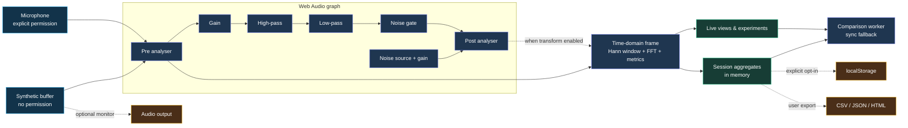
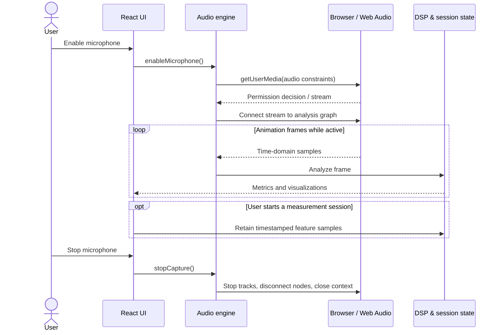

<div align="center">

# GHOSTWIRE.EXE

**ACOUSTIC PRIVACY RESEARCH // CLIENT-SIDE DSP LABORATORY**

*Your microphone reveals more than your words.*

`REACT 19` · `TYPESCRIPT` · `WEB AUDIO` · `WEB WORKERS` · `VITE`

[Quick start](#quick-start) · [Architecture](#architecture) · [DSP reference](#dsp-reference) · [Experiments](#experiment-index) · [Development](#development) · [Privacy](#privacy--trust-boundaries)

</div>

---

GHOSTWIRE.EXE explores the environmental, behavioral, and hardware metadata that can be inferred from browser audio APIs. It runs in the browser, with explicit microphone consent, without speech transcription or raw audio recording. Synthetic signals let you explore the same analysis path without granting microphone access.

> [!IMPORTANT]
> Acoustic features are **not anonymous by default**. Timestamped aggregates can reveal patterns in a person's environment or activity. Use the lab only with informed consent; handle exports as potentially sensitive data.

## System at a glance

| Surface | What it exposes | Primary output |
|:--|:--|:--|
| **Live monitor** | Waveform, spectrum, spectrogram and signal metrics | Real-time `DspFrame` measurements |
| **Exposure lab** | Five controlled side-channel experiments | Comparisons, heuristics and documented limitations |
| **Synthetic signals** | Locally generated test inputs and numerical checks | Repeatable inputs without microphone permission |
| **Session analysis** | Start, pause, stop, compare and export | Timestamped numerical aggregates; CSV, JSON or HTML |

## Quick start

**Requirements:** Node.js 20+, npm 10+, and a modern browser. Microphone capture requires HTTPS or a localhost secure context and browser permission.

```bash
git clone https://github.com/zazieproductions/GHOSTWIRE.EXE.git
cd GHOSTWIRE.EXE
npm ci
npm run dev
```

Open the URL printed by Vite, typically `http://localhost:5173`. Start with **SYNTHETIC SIGNALS** to explore without a microphone, or explicitly select **ENABLE MICROPHONE** to analyze live input. Use **STOP MICROPHONE** when finished.

### A microphone-free walkthrough

1. In **SYNTHETIC SIGNALS**, choose **Electrical Hum (60 Hz + Harmonics)** and run the DSP numerical checks.
2. In **EXPOSURE LAB → EXP A**, capture Window A. Switch to **Broadband Noise**, capture Window B, and compare their spectral profiles.
3. Select **Frequency Masking (150 Hz Masking 240 Hz)**. In **EXP D**, enable the transformation pipeline and a 200 Hz high-pass filter; observe the change in the dominant frequency.
4. Select **Repetitive Transients (4 Hz Impulses)** and inspect **EXP B** for transient and envelope-periodicity observations.

Results depend on analysis settings and browser behavior; the comparisons are demonstrations, not identity or location tests.

## Architecture

The analysis loop reads time-domain frames from Web Audio analysers on the main thread. The custom DSP implementation computes spectral and temporal features; a worker is used for fingerprint and session comparisons, not for the live FFT.



**Legend:** 🟦 input · 🟪 processing · 🟩 in-memory results · 🟨 optional output or persistence. The microphone is not routed to the audio destination; optional monitoring applies to synthetic audio only. The transformation graph is present in the audio chain; post-transform metrics are sampled when the pipeline is enabled.

### Capture & data lifecycle



Synthetic input uses the same analysis graph, without `getUserMedia`. Session samples are collected at approximately 5 Hz while recording. Only the frame currently displayed carries a time-domain copy: rolling activity, fingerprint and experiment buffers hold derived features, and every capture buffer is released on finish, stop, reset and unmount. Closing or reloading the page discards in-memory data; persistence and exports are separate user actions.

## DSP reference

| Measurement | Meaning and units | Interpretation |
|:--|:--|:--|
| RMS / peak | Full-scale amplitude and `dBFS` | Digital level, **not** calibrated sound pressure |
| Crest factor | Peak-to-RMS ratio in `dB` | Helps distinguish impulsive from steady signals |
| Dominant frequency | `Hz`, interpolated around the strongest FFT bin | A spectral peak, not a source identification |
| Centroid / bandwidth | Magnitude-weighted spectral center and spread in `Hz` | Describes spectral shape |
| Flatness | Geometric-to-arithmetic mean of spectral power | Near zero for tonal signals; higher for noise-like spectra |
| Zero-crossing rate | Normalized crossings and estimated frequency | Frequency estimate is most meaningful for a simple tone |
| Band energy | Low `20–250 Hz`, mid `250–2,000 Hz`, high `2,000 Hz–Nyquist` | Relative distribution across bands |

The radix-2 FFT uses a Hann window and coherent-gain normalization. Dominant-frequency interpolation uses three log-magnitude bins. The live noise-floor tracker adapts asymmetrically; experiment fingerprints also summarize a capture window using a 10th-percentile RMS floor. See [RESEARCH.md](./RESEARCH.md) for formulas, thresholds, and confounders.

### Resolution trade-off

Nominal FFT bin spacing is **Δf = sample rate / FFT size**. Longer windows improve bin spacing but span more time; interpolation can refine a peak estimate without changing the underlying bin spacing.

| FFT size | Window at 48 kHz | Bin spacing at 48 kHz |
|--:|--:|--:|
| 1,024 | 21.3 ms | 46.88 Hz |
| 2,048 | 42.7 ms | 23.44 Hz |
| 4,096 | 85.3 ms | 11.72 Hz |
| 8,192 | 170.7 ms | 5.86 Hz |

> [!NOTE]
> These are calculated examples, not benchmark results. The actual sample rate is determined by the browser's audio context. `dBFS` is relative to digital full scale and cannot be converted to physical `dB SPL` without calibration.

## Experiment index

| ID | Research question | Method | Boundary of inference |
|:--:|:--|:--|:--|
| **A** | How similar are two acoustic environments? | Compare two ephemeral 32-band spectral profiles using cosine similarity, spectral RMSE and floor/band deltas. | Similarity does not establish room or device identity. |
| **B** | Which broad activity patterns are observable? | Threshold-based quiet, tonal, broadband, transient and cadence analysis. | Acoustic morphology cannot reliably identify a specific action. |
| **C** | What device metadata can a browser expose? | Inspect supported constraints, explicitly enumerated devices, requested constraints and actual track settings. | Available labels and capabilities vary with permission and browser. |
| **D** | How do transformations affect observability? | Compare pre/post analysis with gain, filters, gate and optional noise injection. | A changed feature is not proof of privacy or protection. |
| **E** | What can combined channels suggest? | Map observed features and metadata to broad inferences, mitigations and an educational index. | The index is a **non-validated heuristic**, not a probability. |

Each experiment includes its research question, procedure, measurements, limitations and reproducibility notes in the application. [RESEARCH.md](./RESEARCH.md) documents methodology and confounding factors in more detail.

## Privacy & trust boundaries

| State / boundary | Behavior |
|:--|:--|
| 🟢 **Default** | Microphone access is user-initiated; session data is held in memory. Retained buffers are feature-only, and the one raw waveform copy belongs to the frame currently on screen for a single animation frame. No raw PCM recordings are saved. |
| 🟡 **Explicit action** | Device enumeration, local session persistence and export require user action. Persistence uses `ghostwire.exe:sessions:v1` plus a consent marker (`ghostwire.exe:sessions:consent:v1`) in `localStorage`, so a reload restores the sessions you chose to keep instead of deleting them. |
| 🔴 **Sensitive output** | CSV, JSON and HTML exports contain aggregate features that may disclose environmental or behavioral patterns. |
| 🔒 **Production network policy** | The built page's CSP sets `connect-src 'none'`, restricting fetch, XHR, WebSocket and EventSource connections. The development CSP permits Vite connections. |

Use **Clear All Session Data** to remove in-memory sessions and the stored session entry. Browser and OS microphone indicators remain authoritative. Browser processing, device drivers and permission behavior vary; compare requested constraints with actual settings in Experiment C. See [SECURITY.md](./SECURITY.md) for the full privacy architecture and reporting guidance.

## Development

### Commands

```bash
npm run dev               # Vite development server (0.0.0.0:5173)
npm run lint              # TypeScript check
npm test                  # Vitest unit and integration tests
npm run test:watch        # Vitest watch mode
npm run check:complexity  # Fail on critical cyclomatic complexity (>= 25)
npm run build             # Complexity guard + TypeScript build + Vite bundle
npm run preview           # Serve dist/ (0.0.0.0:4173)
npx playwright install chromium
npm run test:e2e           # Playwright against the production preview
```

Build before running E2E: Playwright starts `npm run preview` and uses Chromium with fake microphone device and permission flags. Browser installation requires access to Playwright's browser download servers. Production assets are emitted to `dist/`; Vite uses a relative base path for static hosting. HTTPS is required for microphone capture outside localhost.

### Code map

```text
src/
├── App.tsx                  # UI shell and controller composition
├── app/                     # State hooks, engine lifecycle, controls and chrome
├── audio/audioEngine.ts     # Web Audio graph, capture and frame loop
├── dsp/                     # FFT, metrics, analysis and synthetic generation
├── workers/                 # Comparison worker and synchronous fallback
├── components/
│   ├── views/               # Main application screens
│   ├── experiments/         # Exposure experiments A–E
│   └── visualizations/      # Waveform, spectrum and spectrogram canvases
├── types/acoustic.ts        # Shared signal and session types
├── utils/exportSession.ts   # CSV, JSON and HTML exports
└── __tests__/               # App integration tests
scripts/                     # Deployment complexity guard
e2e/                         # Playwright browser tests
```

When changing a metric, update its implementation in `src/dsp/`, its tests in `src/dsp/__tests__/`, and the units and limitations in [RESEARCH.md](./RESEARCH.md). When changing capture, persistence or export behavior, review [SECURITY.md](./SECURITY.md) and the relevant integration and browser tests. Worker comparison requests are defined in `src/workers/dsp.worker.ts`; if a worker cannot be created, the client uses synchronous comparison functions.

### Technical audit & remediation

The [technical audit](./AUDIT.md) documents the current privacy, measurement and reliability findings, with evidence and a prioritized [remediation checklist](./AUDIT.md#remediation-checklist) for tracking proposed changes. The P0 findings (raw-waveform retention and capture cancellation races) and the persistence, band-comparability and CSV-export findings are implemented and covered by regression tests; the audit records the status of every item.

### Automated checks

Three GitHub Actions run alongside the commands above:

| Workflow | Trigger | Purpose |
|:--|:--|:--|
| [`Slop Scan`](./.github/workflows/slop-scan.yml) | push to `main`, pull requests | Verifies that every npm package named in code and documentation exists on the registry, catching slopsquatting targets. |
| [`Roast My Codebase`](./.github/workflows/roast.yml) | pull requests | Posts an advisory code-health comment (complexity, dead exports, tracked secrets, missing tests). It does not gate merges. |
| [`Update Changelog`](./.github/workflows/update-changelog.yml) | published releases | Prepends release notes to [`CHANGELOG.md`](./CHANGELOG.md) and advances the `Unreleased` compare link. |

Only the changelog workflow requests write access (`contents: write`); the scanning workflows run with a read-only token. These checks complement, and do not replace, `npm run lint`, `npm test` and `npm run test:e2e`. `npm run build` additionally fails on any function at or above the Roast critical complexity threshold (25), so critical complexity findings cannot reach a production bundle.

## License

[MIT](./LICENSE)
